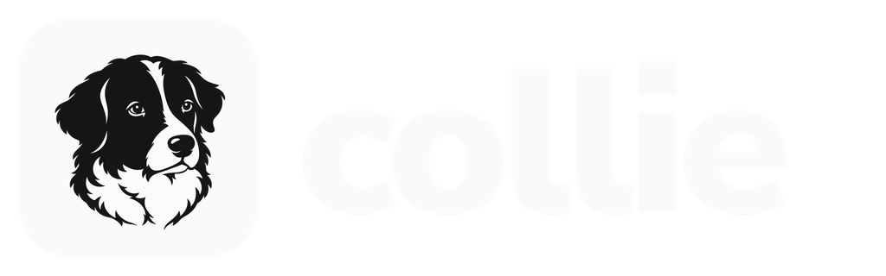
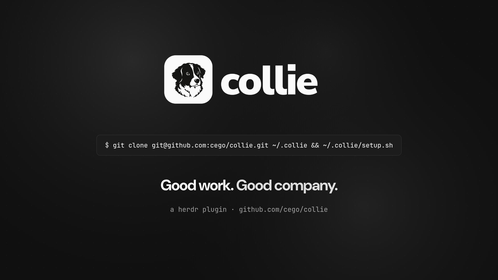

Running several coding agents at once turns into babysitting: one tab per agent, each
waiting on you at a different moment, and no single place that says what needs a decision.
Collie is the herdr plugin that takes that coordination off your hands. You pick a workflow,
Collie opens the tabs, runs the agents, reviews their work, and brings you back only for the
decisions that are yours. One board shows every task in the session: what needs you, what
is working, what finished.

[](assets/video/collie-launch.mp4)

## Install

Run one command. It's safe to run again, and it ends by telling you whether you're ready or
what's still missing and how to fix it:

```sh
curl -fsSL https://github.com/cego/collie/releases/latest/download/setup.sh | sh
```

Collie Desktop, one board for every Machine you reach with the Flock chat beside it, is
released for Linux (x64) and macOS (Apple silicon), and installs with one more command; see
[Collie Desktop](docs/using.md#collie-desktop) for the detail:

```sh
curl -fsSL https://github.com/cego/collie/releases/latest/download/install-desktop.sh | sh
```

Before you run setup.sh, you need:

- **herdr** installed and started once. See the [herdr install guide](https://herdr.dev/docs/install/).
- **A `glab auth login` to `gitlab.cego.dk`**, so the workflows can open merge requests there.
- **Claude Code**, logged in. The bundled workflows run their agents on it.

Nothing from GitHub: the repository and its releases are public, and the install needs no
git. To work on Collie itself, clone cego/collie anywhere and run its `prepare.sh`; see
[Running a checkout of Collie](docs/using.md#running-a-checkout-of-collie). `collie onboard`
installs herdr, Claude Code and Collie at a release instead, one reported step at a time; see
[Onboarding a Machine](docs/using.md#onboarding-a-machine).

The install links the plugin, puts `collie` on your PATH, installs
the required skills, and runs `collie doctor`. Later, `collie upgrade` brings all of it up
to date. Helle and a Linear MCP are optional; doctor tells you when a workflow you'd run
needs one. See [Install](docs/using.md#install) and
[Optional integrations](docs/using.md#optional-integrations) for the detail.

## The board and chat

Each Machine's host keeps two herdr-core terminals in the Herd's own directory: the
**Control Plane**, `collie-board`, a board with one card per task, grouped by what needs
you, what is working, and what finished; and `collie-chat`, where you can ask about the work
or redirect it. `hc attach collie-board` opens the board, and the host starts either again
when it ends. Desktop draws the same board and its own chat.

From a shell, `collie run start` runs a workflow (`--task` continues one), `collie run
resume` picks up a run that stopped, `collie persona fork` copies a persona into your layer
and `collie host restart` restarts the host.

## The workflows

| Workflow       | What it does                                                                                                                                              |
| -------------- | --------------------------------------------------------------------------------------------------------------------------------------------------------- |
| `plan`         | Interviews you about the goal, writes `SPEC.md` and tickets into the run directory, then offers: implement now, second opinion, offload to Linear, refine |
| `implement`    | Builds from a plan, a Linear issue, or a description on a branch of its own, has the change reviewed, fixes the findings, then opens the merge request    |
| `review`       | Reviews a merge request, a branch diff, or the working tree, writes one review, and offers to post it                                                     |
| `architecture` | Runs the architect over the project, reports into the run directory, then offers: implement now or stop                                                   |
| `investigate`  | Runs one investigator on the Machine that can observe the problem, reports findings to the requesting agent, then closes                                  |
| `renovate`     | Merges the month's Renovate merge requests on one repository, tags a release, and checks the repository off the team's Renovate issue                     |
| `general`      | One agent does one ad-hoc task where you started it, with no branch or merge request, and the run ends with its summary                                   |
| `heal`         | Started by the host, not you, for a park its own recovery could not clear: gets the Run moving through its own agents before it needs you                 |

The bundled workflows are a shared starting point, not a restriction. `collie workflow
fork <id>` writes a module of your own that imports what it keeps and replaces what it
changes, and a workflow you write yourself is found where you saved it. A persona forks into
your own layer with `collie persona fork`, changing only the keys you disagree with.

Every action is also a command, so an agent can drive Collie:

```sh
collie run start review --input target=worktree --input plan= --input proves=
```

## Documentation

- [Using Collie](docs/using.md): install, the Control Plane, hand-offs, your
  defaults, troubleshooting.
- [Workflows](docs/workflows.md): what each workflow is for, what it needs, how they chain.
- [Authoring](docs/authoring.md): where a workflow is saved, forking, personas and their frontmatter.
- [CLI](docs/cli.md): commands, `--json` envelopes, exit statuses, idempotent retries.
- [Internals](docs/internals.md): architecture, the host, build and release, running the
  tests.
- [`CONTEXT.md`](CONTEXT.md): the vocabulary.
- [ADRs](docs/adr): the decisions and why.
- [`AGENTS.md`](AGENTS.md): where an agent working on this repo starts.
- [Brand guide](assets/brand/README.md) and [brand showcase](assets/brand/index.html):
  logos, icons, color, typography, and usage. Open the showcase in a browser, or publish
  the `assets/` directory with any static host; it has no build step.

Where Collie is going: [PRODUCT.md](PRODUCT.md).
